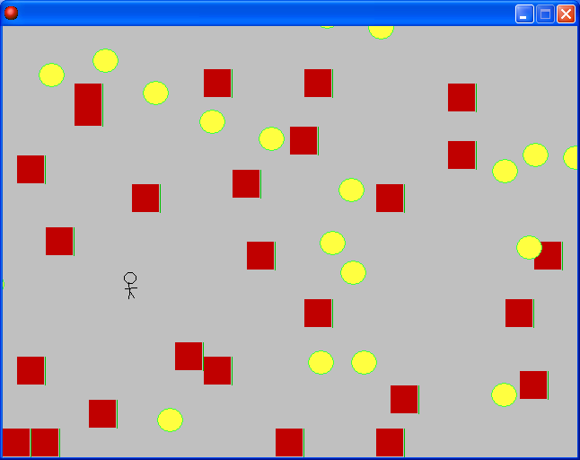

# 못깨요

[English](README.md)

제목 그대로 깰 수 없는 게임을 만들자는 콘셉트로 게임메이커 커뮤니티 이벤트에 낸 게임이다. 빨간 벽과 튀어다니는 공이 빽빽하게 깔린 필드를 뚫고 나가야 한다.

  

## 플레이 방법

Releases에서 받아 실행하면 된다.

방향키로 움직이고 스페이스로 샷건을 쏜다. 달리는 중에는 쏠 수 없고 공에 닿으면 죽는다.

샷건에는 총알끼리 겹치면 서로 사라지는 규칙이 하나 있다. 그래서 마구 연사하면 총알이 자기들끼리 부딪혀 코앞에서 전부 없어진다. 한 발씩 간격을 두고 쏴야 멀리까지 나간다.

## 구현 원리

총알 오브젝트에 자기 자신과 부딪히는 충돌 이벤트를 걸고 자기를 없애는 액션을 넣은 게 전부다. 부딪힌 두 총알 모두에서 이벤트가 돌아 둘 다 사라진다. 액션 하나로 연사 타이밍을 신경 써야 하는 규칙이 생겼는데 깰 수 없는 게임이라는 콘셉트와도 맞는다.

## 파일

| 경로 | 내용 |
|---|---|
| `source/cant-clear-it.gmk` | 원본 프로젝트 파일 |
| `source/split/` | GmkSplitter로 분해한 텍스트 트리 |
| `docs/screenshots/` | 스크린샷 |
| Releases | 배포용 파일 |

## 라이선스

CC BY-NC-ND 4.0 라이선스다. 출처를 밝히면 비상업 용도로 그대로 공유할 수 있고, 수정본 배포와 상업적 이용은 금지한다. 함께 들어 있는 것 중 다른 사람이 만든 라이브러리와 그림·소리·맵은 각자의 권리를 따른다. 자세한 내용은 [LICENSE](LICENSE) 에 있다.
